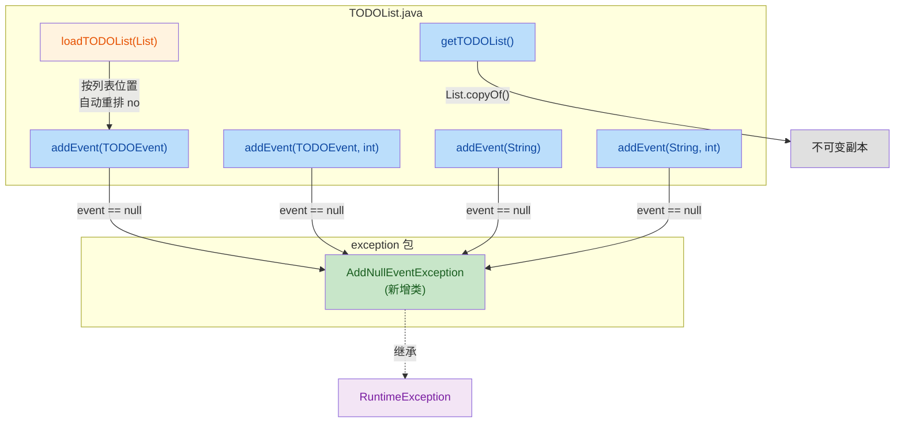
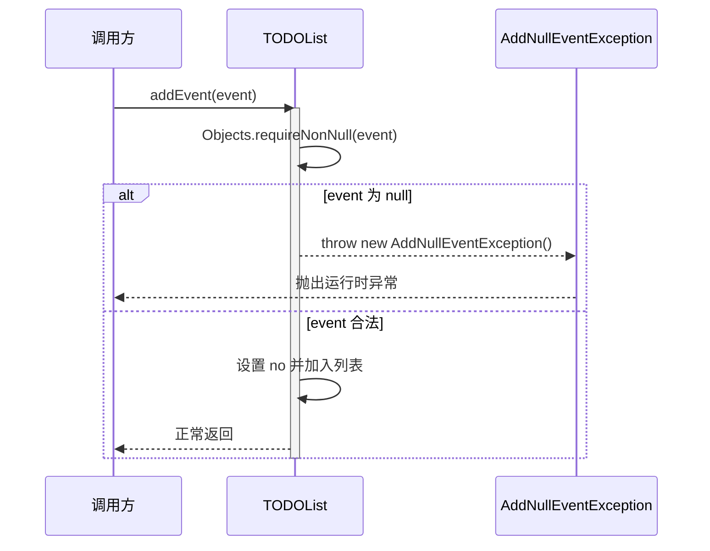

## 1. 高层次摘要 (TL;DR)

*   **影响等级：** 🟡 **中等** — 增强了 TODOList 模块的健壮性和数据完整性，涉及接口重命名与异常体系新增。
*   **核心变更：**
    *   ✨ **新增异常类：** 引入 `AddNullEventException` 以提供更明确的空值错误反馈。
    *   🛡️ **空值校验：** 所有 `addEvent` 方法均增加了 `null` 检查，阻断空事件插入。
    *   🔄 **API 重命名与增强：** `setTODOList` 重命名为 `loadTODOList`，并在导入时自动重排 `no` 序号。
    *   🔒 **不可变快照：** `getTODOList()` 返回不可变副本，避免外部直接修改内部状态。
    *   📁 **忽略文件：** `.gitignore` 新增 `TODO/docs/` 目录。

---

## 2. 可视化概览 (代码与逻辑映射)

下图展示了 `TODOList` 的核心交互流程、相关文件及关键方法，突出了空值校验的异常抛出路径。



**业务流程图：addEvent 空值校验路径**



---

## 3. 详细变更分析

### 📦 异常体系 (新增模块)

*   **新增文件：** `TODO/src/main/java/exception/AddNullEventException.java`
*   **变更说明：** 创建一个继承自 `RuntimeException` 的非受检异常，用于表示「添加空事件」的业务错误。
*   **关键代码：**

    ```java
    package exception;

    public class AddNullEventException extends RuntimeException {
        public AddNullEventException(String message) { super(message); }
        public AddNullEventException(String message, Throwable cause) { super(message, cause); }
    }
    ```

### 📋 核心类 `TODOList.java` 变更

#### 🔁 方法重命名与重排逻辑

| 原方法名 | 新方法名 | 行为变更 |
| :--- | :--- | :--- |
| `setTODOList(List<TODOEvent>)` | `loadTODOList(List<TODOEvent>)` | 导入列表后，**遍历重写每个事件的 `no`**，使其与列表索引一致 |

#### 🛡️ 统一空值校验

所有四个 `addEvent` 重载方法都在入口处加入了以下模板代码：

```java
try {
    Objects.requireNonNull(event, "event 不能为空");
} catch (NullPointerException e) {
    throw new AddNullEventException(e.getMessage(), e);
}
```

| 受影响方法 | 校验对象 |
| :--- | :--- |
| `addEvent(TODOEvent event)` | `event` |
| `addEvent(TODOEvent event, int no)` | `event` |
| `addEvent(String event)` | `event` |
| `addEvent(String event, int no)` | `event` |

#### 🔒 Getter 返回不可变副本

```diff
- return TODOList;
+ return List.copyOf(TODOList);
```

*   **作用：** 防止外部调用者直接修改内部 `TODOList`，强制通过 `addEvent` 等接口维护 `no` 序号的一致性。

#### 📝 插入位置后的序号重排

| 方法 | 重排范围 | 说明 |
| :--- | :--- | :--- |
| `addEvent(TODOEvent, int no)` | `i = no; i < size; i++` ✅ | 正确：从插入点之后开始重排 |
| `addEvent(String, int no)` | `i = 0; i < size; i++` ⚠️ | **潜在 Bug：** 从头开始全量重排，效率略低且语义不一致 |

### 📁 项目配置 `.gitignore`

*   **变更说明：** 新增忽略 `TODO/docs/` 目录。
*   **diff 片段：**

    ```diff
      .vscode/
    + TODO/docs/
    ```

---

## 4. 影响与风险评估

### ⚠️ 破坏性变更 (Breaking Changes)

| 项目 | 说明 | 应对措施 |
| :--- | :--- | :--- |
| 🔴 **`setTODOList` 已移除** | 原先直接覆盖列表的方法被删除并重命名为 `loadTODOList`。所有调用方必须更新方法名。 | 全局搜索 `setTODOList` 调用点，统一替换为 `loadTODOList`。 |
| 🟡 **`getTODOList` 返回类型语义变化** | 由可变 `List` 变为不可变快照。试图调用 `.add()`、`.remove()` 等变更方法将抛出 `UnsupportedOperationException`。 | 调用方若需修改，请改用 `loadTODOList` 或 `addEvent`。 |

### 🐛 潜在 Bug 提示

*   **`addEvent(String event, int no)` 序号重排范围不一致** (Source: `TODOList.java`)
    *   与 `addEvent(TODOEvent, int no)` 不同，此方法从 `i = 0` 全量重排。建议统一为 `i = no` 以保证语义和性能一致。

### 🧪 测试建议

*   **空值场景：** 分别对四个 `addEvent` 重载传入 `null`，验证是否抛出 `AddNullEventException`，且 message 为 `"event 不能为空"`。
*   **不可变副本：** 调用 `getTODOList()` 后尝试 `add/remove/clear`，应抛出 `UnsupportedOperationException`。
*   **序号一致性：**
    *   调用 `loadTODOList`，传入乱序 `no` 的列表，验证所有事件的 `no` 是否被重写为列表索引。
    *   调用 `addEvent(event, 2)`，验证 `index >= 2` 处的事件 `no` 是否全部加 1。
*   **边界条件：**
    *   `addEvent(event, -1)` → 应自动修正为 `0`。
    *   `addEvent(event, size + 100)` → 应自动修正为 `size`。

---

> 📌 **评审结论：** 本次改动提升了 `TODOList` 的数据完整性与防御能力，但 `setTODOList → loadTODOList` 属于 API 重命名，**必须同步更新所有调用点**。建议修复 `addEvent(String, int)` 中的序号重排起点不一致问题。